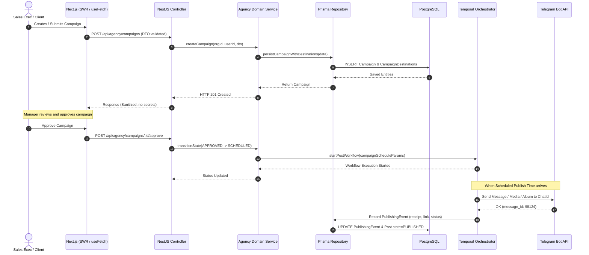
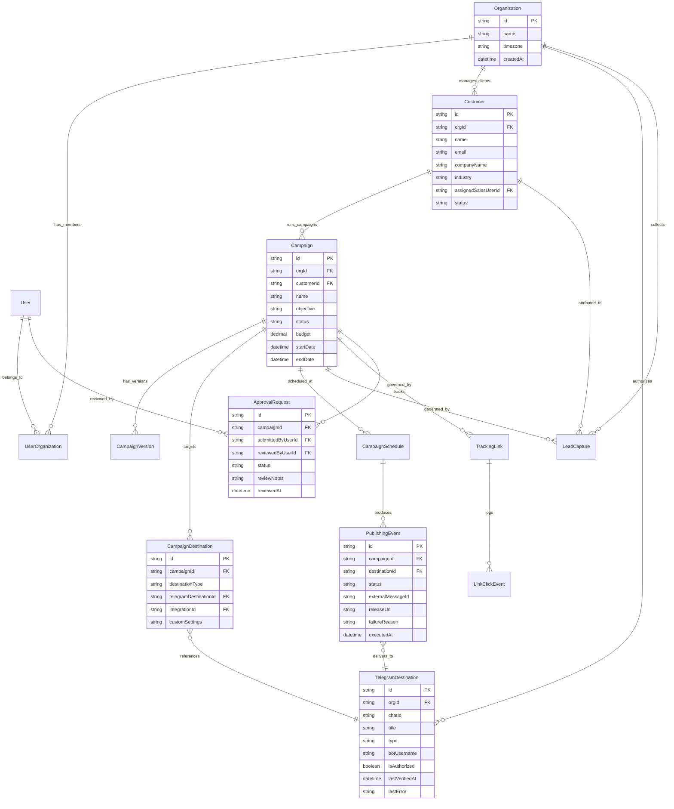

# AgencyOS — System Architecture & Technical Specifications

**Document Version:** 1.0.0  
**Target Platform:** AgencyOS (Built upon Postiz Monorepo Core)  
**Primary Tech Stack:** NestJS, Next.js (App Router), Prisma ORM, PostgreSQL (pgvector), Redis, Temporal.io, Node-Telegram-Bot-API, Tailwind CSS, SWR  

---

## 1. System Overview & Monorepo Topology

AgencyOS is engineered as a high-throughput, enterprise-grade multi-tenant platform managed with `pnpm workspaces`. The architecture reuses and extends Postiz's battle-tested scheduling and connector framework while introducing dedicated agency operating layers.

```
postiz-app-main/
├── apps/
│   ├── backend/                # NestJS 11 REST API Application
│   │   ├── src/api/routes/     # Clean HTTP Controllers (DTO validation & routing only)
│   │   ├── src/services/auth/  # JWT Authentication, Session guards & CASL Abilities
│   │   └── src/public-api/     # Public webhook & tracking endpoints
│   ├── frontend/               # Next.js 14+ (App Router) Frontend Control Panel
│   │   ├── src/app/(app)/      # Main authenticated dashboard routes & layouts
│   │   ├── src/components/     # Modular UI blocks, dialogs, calendar & previewers
│   │   └── src/components/ui/  # Reusable design primitives
│   └── orchestrator/           # Temporal.io Distributed Workflow Engine
│       ├── src/workflows/      # Deterministic state-machine workflows
│       └── src/activities/     # Non-deterministic activities (API calls, DB mutations)
├── libraries/
│   ├── nestjs-libraries/       # Core Business Domain & Shared Services
│   │   ├── src/database/prisma/# Prisma Repositories & Data Models
│   │   ├── src/integrations/   # Social connectors (Telegram, LinkedIn, X, FB, etc.)
│   │   ├── src/services/       # Business logic (Campaigns, Approvals, CRM, Pricing)
│   │   └── src/dtos/           # Class-validator typed DTO definitions
│   ├── react-shared-libraries/ # Shared React Components & Form Controls
│   │   ├── src/form/           # Button, Input, Select, CustomSelect, MultiSelect, Textarea
│   │   └── src/toaster/        # Enterprise Toast notification system
│   └── helpers/                # Cross-tier utilities (custom.fetch, formatting)
└── docs/                       # Architectural and technical documentation
```

---

## 2. Layered Architecture & Request Pipeline

To maintain strict maintainability and survive upstream changes, all backend interactions follow the non-negotiable layered convention:

$$\text{HTTP Request} \longrightarrow \text{DTO (Validation)} \longrightarrow \text{Controller} \longrightarrow \text{Service (Business Logic)} \longrightarrow \text{Repository} \longrightarrow \text{Prisma DB}$$



---

## 3. Multi-Tenant Organizational Domain Model

Data isolation is guaranteed at the database layer. All core entities are linked directly or transitively to an `Organization` (representing the Agency Tenant) and enforced through tenant context extractors (`@GetOrgFromRequest()`).



---

## 4. Telegram Advertising Engine Architecture

The Telegram module strictly respects official Telegram Bot API boundaries while delivering scalable, multi-destination publishing.

### 4.1 Authorization & Verification Pipeline
1. **Bot Registration:** The agency links its dedicated or shared Telegram Bot (`TELEGRAM_TOKEN`).
2. **Channel/Group Onboarding:** The administrator invites the bot to the destination channel or group as an Administrator.
3. **Instant Verification:** The system calls `telegramBot.getChat(chatId)` and `telegramBot.getChatMember(chatId, botId)`.
4. **Capability Checklist:**
   - Channel: Must possess `can_post_messages` and `can_edit_messages`.
   - Supergroup: Must possess `can_send_messages` (or bot not restricted) and optionally `can_delete_messages` for moderation.
5. **Idempotency Keying:** All outgoing messages include a cryptographic hash `SHA256(campaignId + destinationId + scheduleTimestamp + contentHash)` stored in Redis and the `PublishingEvent` table. If a worker retries, it verifies if a message ID already exists before resending.

### 4.2 Throttling & Rate-Limit Management
- Telegram allows up to **30 messages per second** across all chats, and **1 message per second per individual chat**.
- A Redis token-bucket / Bottleneck queue is placed in front of `TelegramProvider` to enforce:
  - Max 20 calls/sec global rate.
  - Max 1 post per chat per 3 seconds.
  - Automatic exponential backoff when encountering HTTP 429 (`parameters.retry_after`).

---

## 5. Temporal Workflow & Publishing Orchestration

Background tasks are decoupled from the web tier via Temporal.io:
1. **`CampaignWorkflow`**: Schedules execution timers for each planned posting window.
2. **`PublishActivity`**:
   - Fetches fresh destination authorization status.
   - Verifies the campaign has not been paused or cancelled (`isCancelled` check).
   - Calls `SocialProvider.post(...)`.
   - Records `PublishingEvent` with `externalMessageId` and canonical `releaseURL`.
   - On unrecoverable error (e.g. Bot removed as admin): marks destination status as `SUSPENDED_UNAUTHORIZED`, pauses affected remaining posts for that destination, and raises an alert to the Campaign Manager.

---

## 6. AI Marketing Copilot Architecture

The AI module is architected with a decoupled provider interface (`IAiProvider`):

```mermaid
graph LR
    UI[Frontend Copilot UI] -->|Prompt + Context| Backend[Agency AI Controller]
    Backend --> Manager[Agency AI Service]
    Manager --> Router{Provider Selector}
    Router -->|Local/Offline| Ollama[Ollama Provider (Qwen 2.5 / Gemma 3)]
    Router -->|Cloud API| OpenAI[OpenAI Compatible Provider]
    Router -->|Agent Framework| Mastra[Mastra AI Framework]
    
    Ollama --> Result[Structured JSON / Copy Suggestions]
    OpenAI --> Result
    Mastra --> Result
    Result --> Buffer[Editable Content Composer Buffer]
```

- **Resilience Policy:** If the AI provider is offline, unreachable, or times out, the core application and scheduler remain 100% operational.
- **Privacy Standard:** Client PII and secret credentials are never included in prompts sent to third-party model providers.

---

## 7. Storage, Embeddings & Semantic Search Architecture

- **PostgreSQL with pgvector:** Used for storing document embeddings for approved campaign decks, creative guidelines, and authorized discussion intelligence.
- **Media Asset Storage:** Modular storage handler with local filesystem fallback for development (`/var/uploads`) and S3/Cloudflare R2 for production.
