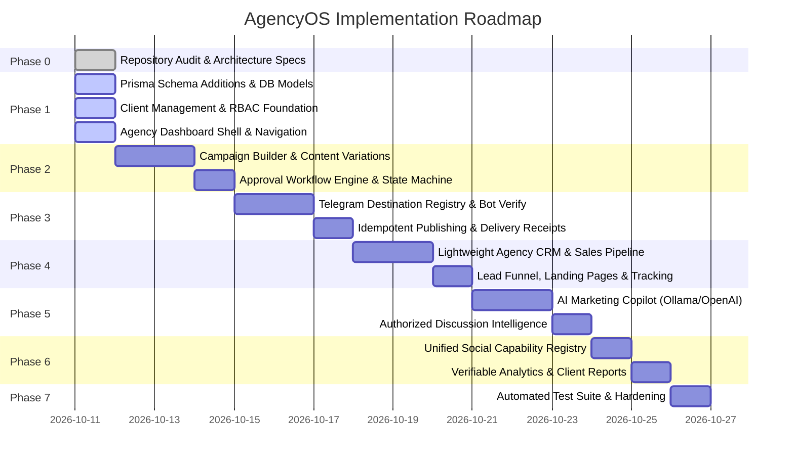

# AgencyOS — Detailed Implementation Roadmap & Milestone Plan

**Document Version:** 1.0.0  
**Target Completion:** Production-Ready MVP & Enterprise Agency Modules  
**Estimated Timeline:** Incremental sprints with working software at every milestone  

---

## 1. Roadmap Overview & Phased Milestones

---

## 2. Phase-by-Phase Deliverables & Verification Criteria

### Phase 0: Repository Audit & Technical Baseline (Completed)
- [x] Full source tree audit of `apps/backend`, `apps/frontend`, `apps/orchestrator`, `libraries/nestjs-libraries`.
- [x] Identification of database models, authentication guards, and Temporal activities.
- [x] Verification of `TelegramProvider` capabilities and API boundaries.
- [x] Production of PRD, Architecture, and Gap Analysis specifications.

### Phase 1: Agency Foundation (Multi-Tenancy, Clients, RBAC & Dashboard Shell)
- **Database:**
  - Add `Client` (extended `Customer`), `Role` hierarchy, and tenant indexing to `schema.prisma`.
  - Create database migration script / update Prisma client.
- **Backend:**
  - `AgencyClientsService` and `AgencyClientsRepository`: CRUD for client profiles, notes, assigned sales reps.
  - `AgencyDashboardService`: Aggregated metrics for active campaigns, pending reviews, revenue, and delivery rates.
  - REST endpoints under `/agency/clients` and `/agency/dashboard`.
- **Frontend:**
  - Register top-level navigation routes in `apps/frontend/src/components/layout/top.menu.tsx`.
  - Create Agency Executive Dashboard view (`/agency/dashboard`).
  - Create Client Directory & Onboarding Modal (`/agency/clients`).
- **Acceptance Criteria:**
  - An agency administrator can onboard a new client with business details and assigned sales rep.
  - Dashboard renders real KPIs pulled from the database without errors.

### Phase 2: Campaign Operations & Approval Workflow
- **Database:**
  - Add `Campaign`, `CampaignDestination`, `CampaignVersion`, `ApprovalRequest`.
- **Backend:**
  - `AgencyCampaignService`: Create, update, duplicate, and validate campaigns.
  - `AgencyApprovalService`: Lifecycle transitions (`Draft` → `Submitted` → `Under Review` → `Approved` / `Changes Requested`).
  - REST endpoints under `/agency/campaigns` and `/agency/approvals`.
- **Frontend:**
  - Multi-step Campaign Creation Wizard (`/agency/campaigns/new`).
  - Campaign Directory & Status Filters (`/agency/campaigns`).
  - Approval Inbox with diff view and approval action modals (`/agency/approvals`).
- **Acceptance Criteria:**
  - Sales representative creates a draft campaign, specifies budget and creative, and submits for review.
  - Campaign Manager receives notification in Approval Inbox and approves/rejects with audit notes.
  - Unapproved campaigns are prevented from scheduling.

### Phase 3: Authorized Telegram Advertising Engine
- **Database:**
  - Add `TelegramDestination` (chatId, title, type, botPermissions, isAuthorized) and `PublishingEvent` (receipts).
- **Backend:**
  - `AgencyTelegramService`: Verify bot admin status via `getChatMember`, register destinations, check throttles.
  - Fan-out scheduling logic connecting approved campaigns to `TelegramProvider`.
  - Idempotency key verification preventing duplicate posts.
  - REST endpoints under `/agency/telegram`.
- **Frontend:**
  - Telegram Destination Management View (`/agency/telegram`).
  - Bot Verification Tester & Onboarding Wizard.
  - Publishing Delivery Logs showing external message IDs and live links (`https://t.me/...`).
- **Acceptance Criteria:**
  - System verifies bot administrator permissions before allowing a destination to be registered.
  - Scheduled post delivers to authorized channel/group, records external `message_id`, and generates clickable `t.me` link.
  - Revoked permissions prevent future deliveries and alert the manager.

### Phase 4: Sales Pipeline, CRM & Community Growth
- **Database:**
  - Add `AgencyLead`, `AgencyDeal`, `LeadCapture`, `TrackingLink`, `LinkClickEvent`.
- **Backend:**
  - `AgencyCrmService`: Pipeline stages, deals, quote generation.
  - Public lead capture and UTM tracking redirect endpoint.
  - REST endpoints under `/agency/crm` and `/public/c/:code`.
- **Frontend:**
  - Kanban / Table Sales Pipeline view (`/agency/crm`).
  - Campaign Lead Capture Builder & QR code generator.
- **Acceptance Criteria:**
  - Sales pipeline manages prospects through deal stages.
  - Tracking link captures clicks and redirects to target landing page or Telegram community.

### Phase 5: AI Marketing Copilot & Discussion Intelligence
- **Backend:**
  - `AgencyAiService`: Modular interface supporting local Ollama (`qwen2.5:3b`, `gemma3:4b`), OpenAI-compatible APIs, and Mastra.
  - Endpoints for ad copy generation, caption polishing, multilingual variations, and CTA recommendations.
  - Asynchronous background execution ensuring scheduler is never blocked.
- **Frontend:**
  - Embedded AI Copilot drawer in Campaign Composer.
  - One-click copy insertion into the editable buffer.
- **Acceptance Criteria:**
  - User generates tailored marketing copy across multiple tones.
  - Core scheduling continues uninterrupted even when AI service is offline.

### Phase 6: Cross-Platform Extensions & Reporting
- **Backend:**
  - Capability Registry describing supported features across Telegram, LinkedIn, X, Facebook, Instagram, YouTube, TikTok.
  - Export service generating structured CSV and PDF campaign reports.
- **Frontend:**
  - Multi-platform campaign previewer.
  - Client Performance Report export view.
- **Acceptance Criteria:**
  - Disallows unsupported actions (e.g. video upload on platforms with file limits) with clear warnings.
  - Client reports export verified stored metrics.

### Phase 7: Production Hardening & Test Suite
- **Verification:**
  - Automated tests covering the 13 required test scenarios (RBAC isolation, approval gating, Telegram idempotency, failover, etc.).
  - Security audit verifying credential protection and tenant isolation.
  - Docker Compose configuration for low-cost VPS and 16 GB laptop local development.
